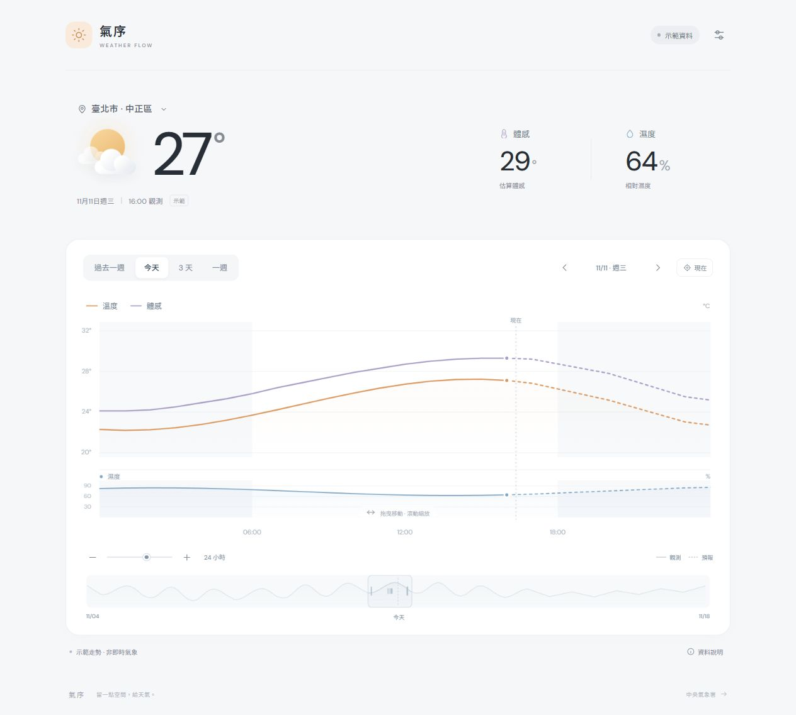

# 04 · 第一版範本

整理日期：2026-11-11

[返回文件目錄](README.md) · [需求](01-需求.md) · [待辦](06-後續工作.md)

## 範本定位

這是已做出的可操作全前端視覺範本，暫名「氣序 · Weather Flow」。它展示溫度、體感與濕度的連續時間軸，讓使用者檢視閱讀方式與操作感受。

**完成的是前端範本與資料接入程式。預設數字為合成示範資料，尚未完成有效授權碼的官方連線驗證。**

這裡的「範本」指目前 Web App，不是另一套可安裝的技能或產生器。

## 版本與預覽

- [私人預覽網站](https://weather-flow-how-1111.howie513579.chatgpt.site/)
- 部署日期：2026-11-11。
- 第一版應用程式基準提交：`8fa357a10df8b9200d8c0cbbc7bfebbd91e12071`。
- 部署服務回報成功；私人網址需有權限的 ChatGPT 帳號登入。
- 前次瀏覽器確認到登入頁，未完成登入後的線上操作驗證。下面的截圖與畫面檢查來自本機預覽。

## 第一版畫面



此截圖為 2026-11-11 的示範畫面，數字不是真實天氣；後續版本可能有所不同。

## 已實作功能

| 編號 | 已實作項目 | 對應需求 | 驗證或限制 |
| --- | --- | --- | --- |
| I01 | 無框架、無建置步驟的靜態前端。 | R02 | 本機 HTTP 預覽可開啟；已完成私人部署。 |
| I02 | 溫度、體感上圖，濕度下圖，共用時間範圍。 | R03、R07 | 已用示範資料檢視畫面。 |
| I03 | 1 小時至 7 天連續縮放。 | R06 | 核心範圍與錨點計算有自動檢查；1 小時是暫行下限。 |
| I04 | 過去 7 天至未來 7 天的平移範圍。 | R05 | 示範資料涵蓋；真實資料完整性待驗證。 |
| I05 | 今天、過去一週、3 天、一週、現在快速定位。 | R04、R05 | 一週定位曾以瀏覽器讀取畫面狀態確認。 |
| I06 | 滾輪、拖曳、滑桿、雙擊與鍵盤控制。 | R06、R09 | 操作處理已實作；跨瀏覽器與觸控板仍待驗證。 |
| I07 | 手機單指平移與雙指縮放。 | R06、R09 | 已寫入手勢處理；不宣稱完成手機實機多指測試。 |
| I08 | 下方兩週總覽及可調整選取框。 | R05、R09 | 已實作；是否保留為最終布局待確認。 |
| I09 | 數值提示、圖例顯示切換與高低範圍陰影。 | R03、R08 | 已實作；長期資料表達待使用者確認。 |
| I10 | 淺色簡約畫面、圖示及過渡動畫。 | R08–R11 | 桌面與手機尺寸已做畫面檢查；視覺是否符合期待待確認。 |
| I11 | 授權碼設定、官方讀取、解析與錯誤提示。 | R01、R02 | 已寫程式，尚未實際驗證官方連線。 |
| I12 | 歷史體感估算與估算標記。 | R03、R05 | 計算與缺風速處理有自動檢查；是否採用待確認。 |
| I13 | 地點偏好與已取得官方觀測的瀏覽器快取。 | 支援目前方案 | 非跨裝置紀錄，不會在關頁後收集。 |
| I14 | 分類 Markdown 文件與範本截圖。 | R12 | 本次文件整理完成後，以實際檔案與連結檢查確認。 |

## 已完成的驗證範圍

第一版製作期間的結果：

| 驗證 | 結果與範圍 |
| --- | --- |
| JavaScript 語法檢查 | 應用程式及核心模組通過當時檢查。 |
| 6 項核心自動檢查 | 通過，涵蓋縮放、邊界、解析、缺值、估算、資料合併與示範資料。 |
| 桌面／手機尺寸畫面檢查 | 使用瀏覽器預覽及截圖檢視；有檢查手機寬度的頁面溢出。 |
| 一週快速定位 | 從畫面狀態確認 7 天與正確起訖時間。 |
| 預覽錯誤訊息 | 當時讀取的瀏覽器錯誤／警告紀錄未顯示項目；不代表所有路徑皆無錯。 |
| 網站部署 | 部署服務回報成功；私人登入後的操作未完成驗證。 |

自動檢查使用的是專案內的測試用資料，並非即時向氣象署取得資料。本次只整理文件，不把先前檢查描述為新一輪測試。

## 尚未完成或尚未定案

- 有效授權碼下，四類官方資料能否直接由正式網站讀取。
- 六個預設地點的測站對應、過去一週完整性與更新時間。
- 實機雙指、上下捲動、連續縮放與長時間使用體驗。
- 過去體感估算方式是否符合使用者需求。
- 名稱、配色、文字量、字級與圖表布局的最終確認。
- 「近幾天」的定義、首頁置中方式、最小縮放範圍與最終地點選擇。

詳細編號與完成條件統一放在 [06-後續工作.md](06-後續工作.md)。

## 檔案對照

| 檔案 | 用途 |
| --- | --- |
| [dist/index.html](../dist/index.html) | 頁面結構、圖示、控制項與資料說明。 |
| [dist/style.css](../dist/style.css) | 視覺、響應式排版與動畫。 |
| [dist/app.js](../dist/app.js) | 圖表繪製、縮放平移、互動及官方資料讀取。 |
| [dist/core.mjs](../dist/core.mjs) | 時間範圍、地點設定、體感公式與資料解析。 |
| [dist/favicon.svg](../dist/favicon.svg) | 網站圖示。 |
| [core.test.mjs](../core.test.mjs) | 6 項核心自動檢查。 |
| [.openai/hosting.json](../.openai/hosting.json) | 現有私人網站的部署設定。 |

## 本機重開方式

在專案目錄執行：

```powershell
python -m http.server 4173 --bind 127.0.0.1 --directory dist
```

然後開啟 [本機預覽](http://127.0.0.1:4173)。此連結需要本機伺服器正在執行，不能當成永久線上網址。

需要重新檢查核心功能時：

```powershell
node --test core.test.mjs
```
